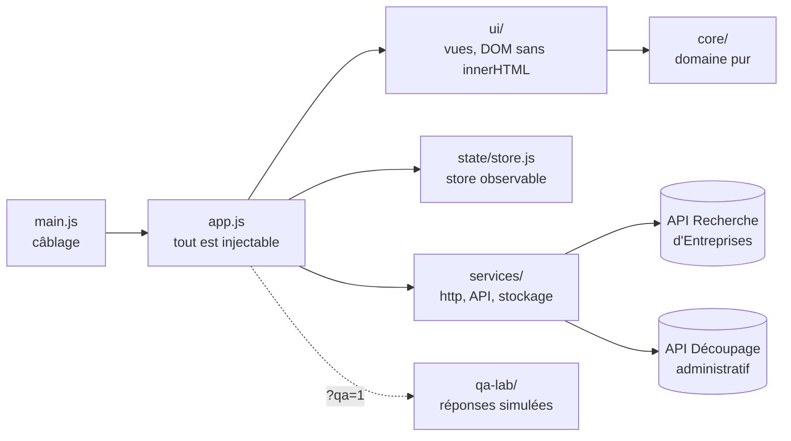
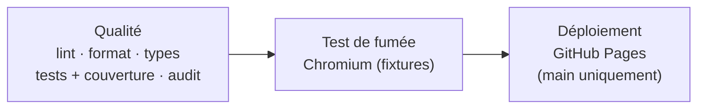

<div align="center">

# 🔎 French Companies Explorer

**Une application de recherche d'entreprises françaises, conçue comme terrain d'entraînement QA : tests manuels, tests d'API, cohérence API ↔ interface et automatisation E2E.**

[](https://github.com/maximejoannis/french-companies-explorer-qa/actions/workflows/ci.yml)
[](https://maximejoannis.github.io/french-companies-explorer-qa/)
[](CHANGELOG.md)
[](#-qualité-et-tests)
[](#-qualité-et-tests)
[](docs/AUDIT.md)
[](#-qualité-et-tests)

[](src)
[](index.html)
[](styles.css)
[](tsconfig.json)
[](https://vitest.dev/)
[](eslint.config.js)
[](https://prettier.io/)
[](.nvmrc)

[-000091>)](https://recherche-entreprises.api.gouv.fr/docs/)
[](package.json)
[](manifest.webmanifest)
[](#-pour-lautomatisation-playwright)
[](PRIVACY.md)
[](src/locales)
[](LICENSE)

**[🌐 Ouvrir l'application](https://maximejoannis.github.io/french-companies-explorer-qa/)** ·
**[🧪 Labo QA](https://maximejoannis.github.io/french-companies-explorer-qa/?qa=1)** ·
**[🔍 Audit v1](docs/AUDIT.md)** ·
**[🔐 Confidentialité](PRIVACY.md)**

</div>

---

## 📑 Sommaire

1. [Présentation](#-présentation)
2. [Démarrage rapide](#-démarrage-rapide)
3. [Fonctionnalités](#-fonctionnalités)
4. [Labo QA](#-labo-qa)
5. [Pour l'automatisation Playwright](#-pour-lautomatisation-playwright)
6. [Commandes npm](#-commandes-npm)
7. [Architecture](#-architecture)
8. [Garde-fous](#-garde-fous)
9. [Confidentialité et RGPD](#-confidentialité-et-rgpd)
10. [Qualité et tests](#-qualité-et-tests)
11. [Documentation](#-documentation)
12. [Déploiement sur GitHub Pages](#-déploiement-sur-github-pages)
13. [Dépannage](#-dépannage)
14. [Licence et sources](#-licence-et-sources)

---

## 🎯 Présentation

French Companies Explorer interroge l'**API Recherche d'Entreprises** (data.gouv.fr) et l'**API Découpage administratif** (geo.api.gouv.fr), deux API publiques, gratuites et sans clé. L'application sert de **terrain d'entraînement QA** : chaque fonctionnalité est pensée pour être testée.

| Pour…                         | Ce que propose l'application                                                                                |
| ----------------------------- | ----------------------------------------------------------------------------------------------------------- |
| **Tests manuels**             | Recherche, filtres, fiches, favoris, comparaison, export : des parcours riches sur des données réelles      |
| **Tests d'API**               | Une vraie API publique, avec ses limites documentées (7 req/s, 25 résultats par page, erreurs 400/404/429)  |
| **Cohérence API ↔ interface** | Les mêmes données visibles dans la réponse JSON et à l'écran (identifiants, finances, établissements…)      |
| **Automatisation E2E**        | Plus de 110 `data-testid` stables, un signal « prêt », un Labo QA qui simule erreurs, latence et hors-ligne |
| **RGPD**                      | Inventaire, export et effacement des données locales, conservation réglable, minimisation, 24 scénarios     |

La **v2** est une refonte complète de la v1.1.1 : architecture modulaire testable, **27 anomalies corrigées** (dont une XSS stockée), garde-fous de sécurité, **16 nouvelles fonctionnalités**, 406 tests et une CI bloquante.

> Les tests unitaires et d'intégration (Vitest) sont dans ce dépôt. Les tests E2E **Playwright** vivent dans un dépôt séparé qui cible cette application.

---

## 🚀 Démarrage rapide

**Prérequis :** [Node.js](https://nodejs.org/) 22 (voir `.nvmrc`) et [Git](https://git-scm.com/). Aucune dépendance n'est livrée au navigateur : les paquets npm servent uniquement au développement.

<details open>
<summary><b>Windows (PowerShell)</b></summary>

```powershell
git clone https://github.com/maximejoannis/french-companies-explorer-qa.git
cd french-companies-explorer-qa
npm ci
npm start
```

</details>

<details>
<summary><b>macOS / Linux</b></summary>

```bash
git clone https://github.com/maximejoannis/french-companies-explorer-qa.git
cd french-companies-explorer-qa
nvm use        # Node 22
npm ci
npm start
```

</details>

Ouvrez ensuite **http://localhost:4173/** (ajoutez `?qa=1` pour le Labo QA). Le port se change avec la variable `PORT`.

> [!NOTE]
> Ouvrir `index.html` directement (`file://`) ne fonctionne pas, car l'application utilise des modules ES. Passez par `npm start` ou par n'importe quel serveur statique.

---

## ✨ Fonctionnalités

| Domaine              | Ce que permet l'application                                                                                                                                                                                            |
| -------------------- | ---------------------------------------------------------------------------------------------------------------------------------------------------------------------------------------------------------------------- |
| **Recherche**        | Nom, mot-clé, SIREN ou SIRET (clé de Luhn vérifiée), autocomplétion accessible, pagination, tri, filtre local, vue cartes ou tableau                                                                                   |
| **Filtres**          | Code postal, commune (résolue en code INSEE), NAF, section NAF, département, région, effectif, état, catégorie (PME/ETI/GE), forme juridique, labels (ESS, RGE, Bio, Qualiopi…), CA et résultat net min/max, dirigeant |
| **Fiche entreprise** | Identifiants, TVA intracommunautaire, siège, structure, labels, finances (tableau et graphique), dirigeants, établissements filtrables et paginés, impression / PDF                                                    |
| **Favoris**          | Notes, tags, recherche, tri, import/export JSON validé, **veille** des changements à l'actualisation                                                                                                                   |
| **Comparaison**      | Jusqu'à 3 entreprises, différences seules, réordonnancement, lien de partage                                                                                                                                           |
| **Proximité**        | Entreprises autour d'une commune ou de votre position (arrondie à ~1 km, jamais stockée), distance, lien OpenStreetMap                                                                                                 |
| **Analyse**          | Répartitions par statut, catégorie, effectif, département et secteur (graphiques SVG accessibles et tableaux) sur 1 à 4 pages de résultats                                                                             |
| **Export**           | CSV (protégé contre l'injection de formules) ou JSON : page courante, toutes les pages (500 lignes max), comparaison ou favoris, colonnes au choix                                                                     |
| **Confort**          | Thème système / clair / sombre, contraste renforcé, densité, animations réduites, taille du texte, raccourcis clavier désactivables, FR/EN                                                                             |
| **PWA**              | Application installable, consultable hors ligne                                                                                                                                                                        |
| **Confidentialité**  | Inventaire des données locales, export, effacement par catégorie ou total, durée de conservation, minimisation, mentions légales                                                                                       |

### ⌨️ Raccourcis clavier

| Touche(s)    | Action                      |
| ------------ | --------------------------- |
| `/`          | Aller au champ de recherche |
| `?`          | Afficher l'aide             |
| `g` puis `s` | Recherche                   |
| `g` puis `f` | Favoris                     |
| `g` puis `c` | Comparaison                 |
| `g` puis `h` | Historique                  |
| `g` puis `n` | À proximité                 |
| `g` puis `p` | Confidentialité             |
| `g` puis `a` | À propos                    |
| `g` puis `o` | Accueil                     |

Les raccourcis sont inactifs dans les champs de saisie et peuvent être désactivés dans les préférences (WCAG 2.1.4).

---

## 🧪 Labo QA

Ajoutez `?qa=1` à l'adresse pour afficher le panneau du Labo QA. Il remplace les appels réseau par des réponses simulées :

| Paramètre d'URL | Valeurs                                                                                       | Effet                                            |
| --------------- | --------------------------------------------------------------------------------------------- | ------------------------------------------------ |
| `qa=1`          | —                                                                                             | Active le Labo QA                                |
| `qaScenario`    | `none`, `fixtures`, `400`, `404`, `429`, `500`, `timeout`, `invalid-json`, `empty`, `offline` | Données fictives déterministes ou erreur simulée |
| `qaLatency`     | nombre de millisecondes                                                                       | Ajoute de la latence à chaque appel              |
| `qaStorage`     | `blocked`, `quota`                                                                            | Simule un stockage bloqué ou plein               |

Exemples :

- Données fictives stables : `?qa=1&qaScenario=fixtures`
- Limite de débit atteinte : `?qa=1&qaScenario=429`
- Réseau lent : `?qa=1&qaScenario=fixtures&qaLatency=3000`
- Stockage plein : `?qa=1&qaScenario=fixtures&qaStorage=quota`

---

## 🤖 Pour l'automatisation Playwright

- **Attendre** `html[data-ready="true"]` avant d'interagir.
- **Données stables** : `?qa=1&qaScenario=fixtures` (aucun appel réseau).
- **Sélecteurs** : plus de 110 `data-testid` stables et jamais traduits ; les sélecteurs de la v1.1.1 sont conservés.
- **État dans l'URL** : la vue (`view`), la recherche, les filtres, la page, le tri et la langue (`lang`) sont repris de l'URL, ce qui permet d'ouvrir directement un état précis.
- **Changements visibles** : voir [MIGRATION.md](MIGRATION.md).

```js
import { test, expect } from "@playwright/test";

test("recherche avec données fictives", async ({ page }) => {
  await page.goto("/french-companies-explorer-qa/?qa=1&qaScenario=fixtures");
  await expect(page.locator("html")).toHaveAttribute("data-ready", "true");
  // … interactions via page.getByTestId('…')
});
```

---

## ⌨️ Commandes npm

| Commande             | Rôle                                                                      |
| -------------------- | ------------------------------------------------------------------------- |
| `npm ci`             | Installe les dépendances exactes du `package-lock.json`                   |
| `npm start`          | Serveur statique local sur http://localhost:4173/                         |
| `npm test`           | Tests unitaires et d'intégration (Vitest + jsdom)                         |
| `npm run test:watch` | Relance les tests à chaque modification                                   |
| `npm run coverage`   | Tests + couverture V8 (`coverage/index.html`), **seuils bloquants**       |
| `npm run lint`       | ESLint, dont `no-unsanitized` (interdit `innerHTML` dynamique, `eval`…)   |
| `npm run typecheck`  | Vérification des types JSDoc (`tsc --noEmit`, `checkJs`)                  |
| `npm run format`     | Met en forme le code (Prettier) ; `format:check` pour vérifier            |
| `npm run check`      | Lint, format, types et couverture : **comme la CI**                       |
| `npm run smoke`      | Test de fumée dans Chromium, en Labo QA « fixtures » (aucun appel réseau) |
| `npm run build:site` | Prépare `_site/` pour GitHub Pages                                        |

---

## 🏗️ Architecture



```
french-companies-explorer-qa/
├── index.html            Structure, CSP, sélecteurs v1.1.1 conservés
├── styles.css            Styles (aucun style inline), thèmes, préférences, impression
├── sw.js                 Service worker (hors ligne)
├── manifest.webmanifest  PWA
├── src/
│   ├── main.js           Seul module à effets de bord
│   ├── app.js            init({ win, transport, storageBackend, now, timers… })
│   ├── config.js         Limites documentées de l'API et constantes
│   ├── core/             Domaine PUR : aucun DOM, réseau ni stockage (règle ESLint)
│   ├── services/         HTTP (timeout, relances, erreurs typées), API, stockage, presse-papiers
│   ├── state/            Store observable
│   ├── ui/               DOM sans innerHTML, routeur, graphiques, vues
│   ├── locales/          fr.js, en.js (parité vérifiée par un test)
│   └── qa-lab/           Labo QA, chargé seulement si ?qa=1, et données fictives
├── tests/
│   ├── unit/             Domaine, services, Labo QA, PWA
│   └── integration/      Application complète montée dans jsdom
├── scripts/              Serveur local, test de fumée, build du site
└── docs/                 Audit, traçabilité, limites, plan de tests RGPD
```

---

## 🛡️ Garde-fous

| Risque                   | Protection                                                                                                                                                                                        |
| ------------------------ | ------------------------------------------------------------------------------------------------------------------------------------------------------------------------------------------------- |
| **XSS**                  | Aucun `innerHTML` : DOM construit avec des nœuds texte ; liens limités à `https:`, `#`, `./`, `blob:` ; ESLint `no-unsanitized` en CI                                                             |
| **Injection de contenu** | CSP stricte (pas de script inline, `connect-src` limité aux deux API), `referrer` restreint, liens externes `noopener noreferrer`                                                                 |
| **Stockage non fiable**  | Origine `*.github.io` partagée : clés versionnées `fce:v2:*`, validation de schéma à chaque lecture, écritures protégées (quota, navigation privée), plafonds (100 favoris, 12 historiques…)      |
| **Réseau**               | Timeout de 8 s, erreurs typées (400, 404, 429, 5xx, réseau, timeout, JSON invalide), 2 relances max avec backoff et `Retry-After`, 5 req/s max (limite de l'API : 7), réponses obsolètes ignorées |
| **Entrées**              | Listes blanches pour tous les paramètres d'URL, longueurs maximales, formats validés avant tout appel                                                                                             |
| **Export CSV**           | Neutralisation des cellules commençant par `=`, `+`, `-`, `@`, une tabulation ou un retour chariot                                                                                                |
| **Dépendances**          | `npm audit --audit-level=high` bloquant en CI                                                                                                                                                     |

---

## 🔐 Confidentialité et RGPD

Même pour un projet personnel, la gestion des données personnelles est intégrée : c'est l'un des scénarios de test les plus courants sur de vrais projets.

- **Aucune collecte** : ni compte, ni cookie, ni mesure d'audience. Les données restent dans le navigateur, et la police est hébergée dans le dépôt (pas de Google Fonts).
- **Page Confidentialité** (`?view=privacy`) : inventaire en temps réel, export JSON (portabilité), effacement par catégorie ou total (stockage v1/v2, session, caches), durée de conservation de l'historique (90 jours par défaut).
- **Minimisation** : dirigeants et position jamais enregistrés ; entrepreneurs individuels et unités en diffusion partielle (`statut_diffusion = "P"`) enregistrés sans nom ni adresse ; colonne « Dirigeants » désactivée par défaut à l'export.
- **Documents** : [PRIVACY.md](PRIVACY.md) (politique et mentions légales) et [docs/RGPD-TESTS.md](docs/RGPD-TESTS.md) (24 scénarios de test prêts à automatiser).

---

## ✅ Qualité et tests

| Indicateur                     | Seuil bloquant                 | Mesuré                           |
| ------------------------------ | ------------------------------ | -------------------------------- |
| Tests                          | tous verts                     | **406** (19 fichiers)            |
| Couverture des lignes          | ≥ 80 % (≥ 90 % sur `src/core`) | **97,7 %** (`src/core` : 99,6 %) |
| Couverture des branches        | ≥ 80 % (≥ 90 % sur `src/core`) | **91,0 %** (`src/core` : 98,0 %) |
| Couverture des fonctions       | ≥ 80 % (≥ 90 % sur `src/core`) | **95,1 %** (`src/core` : 99,0 %) |
| Couverture des instructions    | ≥ 80 % (≥ 90 % sur `src/core`) | **96,2 %** (`src/core` : 99,5 %) |
| Lint, types, format            | 0 erreur                       | 0                                |
| `npm audit --audit-level=high` | 0                              | 0 vulnérabilité                  |

Les tests ne sont pas des tests de façade : des mutations volontaires (neutralisation CSV désactivée, tri des valeurs manquantes inversé, clé de Luhn toujours vraie, rendu HTML au lieu de texte, validation du CA supprimée) font échouer entre 2 et 10 tests à chaque fois.

**CI GitHub Actions**, à chaque push et pull request :



---

## 📚 Documentation

| Document                                     | Contenu                                                           |
| -------------------------------------------- | ----------------------------------------------------------------- |
| [CHANGELOG.md](CHANGELOG.md)                 | Historique des versions                                           |
| [docs/AUDIT.md](docs/AUDIT.md)               | Les 27 anomalies de la v1.1.1, preuves et tests de non-régression |
| [MIGRATION.md](MIGRATION.md)                 | Changements visibles pour le dépôt d'automatisation               |
| [docs/TRACEABILITY.md](docs/TRACEABILITY.md) | Fonctionnalités → fichiers → tests → `data-testid`                |
| [PRIVACY.md](PRIVACY.md)                     | Politique de confidentialité et mentions légales                  |
| [docs/RGPD-TESTS.md](docs/RGPD-TESTS.md)     | 24 scénarios de test RGPD                                         |
| [docs/LIMITES.md](docs/LIMITES.md)           | Limites connues et suites possibles                               |

---

## 🌐 Déploiement sur GitHub Pages

Le déploiement est automatique : chaque push sur `main` lance la CI. Le site n'est publié que si la qualité **et** le test de fumée passent.

1. Dans **Settings → Pages**, choisissez la source **GitHub Actions** (une seule fois).
2. Poussez sur `main`.
3. Suivez l'onglet **Actions** : quand le job « Déploiement GitHub Pages » est vert, le site est à jour.

Aucun serveur, aucune clé d'API, aucun service payant : les deux API utilisées sont publiques et gratuites.

---

## 🩺 Dépannage

| Symptôme                                                          | Solution                                                                                                                                                                                 |
| ----------------------------------------------------------------- | ---------------------------------------------------------------------------------------------------------------------------------------------------------------------------------------- |
| Page blanche avec `file://`                                       | Lancez `npm start` et ouvrez http://localhost:4173/                                                                                                                                      |
| Port 4173 déjà utilisé                                            | PowerShell : `$env:PORT=4174; npm start` · bash : `PORT=4174 npm start`                                                                                                                  |
| `npm` bloqué par PowerShell (« exécution de scripts désactivée ») | `Set-ExecutionPolicy -Scope CurrentUser RemoteSigned`, puis rouvrez le terminal                                                                                                          |
| Message « Trop de requêtes » (429)                                | L'API limite à 7 requêtes par seconde : patientez quelques secondes, l'application relance automatiquement                                                                               |
| Résultats différents d'un jour à l'autre                          | Normal : les données de l'API évoluent. Pour des tests stables, utilisez `?qa=1&qaScenario=fixtures`                                                                                     |
| `npm run smoke` ne trouve pas Chromium                            | Installez-le une fois (`npx playwright-core install chromium`), puis indiquez son dossier. PowerShell : `$env:PLAYWRIGHT_BROWSERS_PATH="$env:LOCALAPPDATA\ms-playwright"; npm run smoke` |
| Repartir de zéro                                                  | Page **Confidentialité** → effacement total des données locales                                                                                                                          |

---

## 📄 Licence et sources

Code sous licence **[MIT](LICENSE)**. Le fichier `LICENSE` contient aussi un avis informatif : la licence ne couvre pas les données des entreprises, qui contiennent des données personnelles et dont toute réutilisation doit respecter le RGPD. Les données du Labo QA sont entièrement fictives.

**Sources**

- API Recherche d'Entreprises : [documentation](https://recherche-entreprises.api.gouv.fr/docs/) · [OpenAPI](https://recherche-entreprises.api.gouv.fr/openapi.json)
- API Découpage administratif : https://geo.api.gouv.fr/
- Police Poppins : SIL Open Font License 1.1 (`assets/fonts/OFL-LICENSE.txt`)
